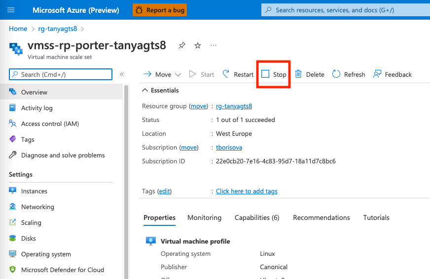
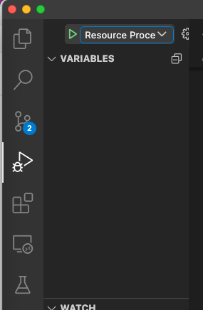
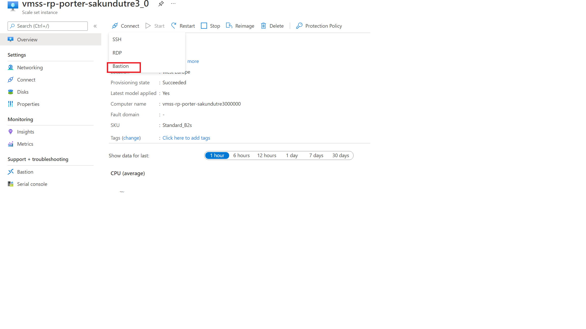
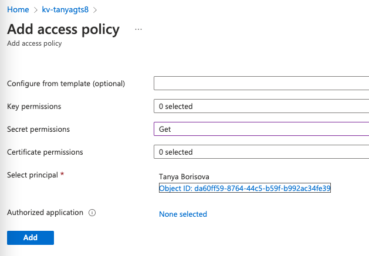

# Resource Processor (VMSS)

Resource Processor is the Azure TRE component automating [Porter](https://porter.sh) bundle deployments. It hosts Porter and its dependencies.

This page is a guide for a developer looking to make a change to the Resource Processor and debug it.

## Overview

The logic in Resource Processor is written in Python. The Resource Processor implementation is located in [`resource_processor` folder](https://github.com/microsoft/AzureTRE/blob/main/resource_processor/) of the repository.

Read [how a workspace is provisioned using Porter](./../azure-tre-overview/architecture.md#provisioning-a-workspace)

## Local debugging

To set up local debugging, first run, if you haven't done so already (make sure `ENABLE_LOCAL_DEBUGGING` is set to `true` in your `.env` file):

```cmd
az login
make setup-local-debugging
```

This will allowlist your local IP against Azure resources and create a Service Principal for the Resource Processor.

Next, disable the existing Resource Processor from running in your deployment. The easiest way to do this is to stop the VM scale set:

[](../assets/rp_stop_vm_scale_set.png)

Now, go to "Run and Debug" panel in VSCode, and select Resource Processor.

[](../assets/rp_local_debugging_vscode_screenshot.png)

!!! info
    If you get a credential error when trying to connect to Service Bus, make sure you've authenticated in the AZ CLI first as it uses your local credentials.

!!! info
    If you get an error similar to `Environment variable 'ARM_CLIENT_ID' is not set correctly`, make sure you have ran `make setup-local-debugging`

You can use an API instance deployed in your environment to create deployment requests, and debug your locally running Resource Processor.

For more information on how to use API, refer to [API documentation](./api.md#using-swagger-ui).

## Cloud instance

On Azure Portal, find an Virtual VM scale set with a name `vmss-rp-porter-${TRE_ID}`.

### Connect to the Resource Processor terminal

The processor runs in a VNET, and you cannot connect to it directly. To SSH to this instance, use Bastion.

1. Navigate to the VMSS instance named `vmss-rp-porter-${TRE_ID}` in the Azure Portal.
1. Click on `Instances` in the left menu.
1. Click on an instance name.
1. Click on `Connect -> Bastion` in the top menu.

  

1. Set `Authentication type` to `Password from Azure Key Vault`.
1. Set Username to `adminuser`.
1. Set the Key Vault to  `kv-${TRE_ID}` and Azure Key Vault Secret to `resource-processor-vmss-password`.

    If you don't have permissions to see the secret, add yourself to the Access Policy of this keyvault with a permission to read secrets:

    [](../assets/rp_kv_access_policy.png)

1. Click `Connect`.


### Getting container logs

1. SSH into the Resource Processor VM as described above
1. Check the status of the container using `docker ps`

    If you see nothing (and the container was pulled) then the processor has either not started yet or it has crashed.

1. Get the logs from the container using `docker logs <container_id>` command.

### Starting container manually

1. Find the **runner_image:tag** by running ``docker ps``
1. Execute the following command from the root (/) of the file system

  ```cmd
  sudo docker run -v /var/run/docker.sock:/var/run/docker.sock --env-file .env --name resource_processor_vmss_porter_debug [runner_image:tag]
  ```

!!! info
    If you start a container manually you will probably want to install software, for example, an editor. However, the firewall blocks all ingress traffic, so you cannot run `sudo apt update`. You need to add an override rule in the firewall to allow the traffic.

!!! caution
    Remember to remove this rule when debugging is done.

## Troubleshooting

### No container logs on the instance

1. If you don't see container logs, you should check the status of **cloud-init** which is used to bootstrap the machine with docker and start the processor. Log files for cloud init are:

   - `/var/log/cloud-init.log`
   - `/var/log/cloud-init-output.log`

   If the Docker container is pulled as shown in logs then the resource processor should start.
1. Check the status of all Docker processes using `docker ps -a` which should show you if the container terminated prematurely.

## Implementation details

### Porter

Azure TRE needed a solution for implementing and deploying workspaces and workspace services with the following properties:

* Means for packaging and versioning workspaces and workspace services
* Providing unified structure for deployment definitions (scripts, pipelines) so that the process can be easily automated
* Solid developer experience - easy to use and learn

Porter meets all these requirements well. Porter packages cloud application into a versioned, self-contained Docker container called a Porter bundle.

<!-- markdownlint-disable MD013 -->
CNAB spec defines actions that Porter [implements](https://porter.sh/author-bundles/#bundle-actions): **install, upgrade and uninstall**. The developer has practically complete freedom on how to implement logic for these actions. The deployment pipeline definition is created in YAML. The YAML file is called [Porter manifest](https://porter.sh/author-bundles/) and in addition to the actions, it contains the name, version, description of the bundle and defines the input parameters, possible credentials and output.

Furthermore, Porter provides a set of [mixins](https://porter.sh/mixins/) - analogous to the concrete actions in GitHub workflows and tasks in Azure DevOps pipelines - which simplify and reduce the development cost when implementing deployment logic. For example, Terraform mixin installs the required tools and provides a clean step in the pipeline to execute Terraform deployments. [Exec mixin](https://porter.sh/mixins/exec/) allows running any command or script; especially useful, if no suitable mixin for a specific technology is available. Implementing custom mixins is possible too.
<!-- markdownlint-enable MD013 -->

### Repeated messages

Service Bus can give the same message to more than one worker. The resource processor uses these rules to prevent a second run of a step:

1. The `workspacequeue` queue keeps a session lock for 5 minutes. While a worker runs a step, it renews the lock every minute. If a renewal fails, the worker tries again until the lock expires, and logs each failure.
1. Before Porter starts, the worker gets a 60-second lease on the blob `rp-executions/<resource ID>` in the management storage account. It renews the lease every 15 seconds. If another worker holds the lease, the worker keeps its session and tries again every 30 seconds.
   When it gets the lease, it renews the session lock. If the session is lost, the worker does not run Porter, because another worker can have the message.
1. The blob holds a record of the last step for the resource and the results of up to 20 earlier steps. If the record shows that the same step finished, the worker does not run Porter. It reads the outputs again and sends the recorded status.
   This also applies to a copy of a message that arrives after other steps for the resource. For example, the API can send a step again.
1. When a step starts, the worker keeps the 20 most recent results as earlier results and removes the other results. An earlier result keeps the first 4,000 characters of its status message, because a status message can be up to 2 MB.
   A copy that arrives after more than 20 other steps for the resource does not find its result, and the worker runs Porter again.
1. If the lease expired before a record write, the worker takes the lease again. It does not replace a record that another worker wrote in the meantime.
   If that record shows the same step as running, the worker writes the result of its Porter run over it. After a Porter run, the worker sends the status also if it cannot write the record.
1. Each status message of a Porter run has an `executionId`. After a step has a final status, the API ignores a status from another run, a later status from the same run and a final status that it already saved.
1. If the API wrote the final status itself, for example after a failed send of the next step, the first run of the step replaces it. An uninstall keeps its earlier rule for a final step.
1. An upgrade does not install a deleted resource again. The resource processor sends `updating_failed` if the last successful action of the Porter installation was an uninstall. Without this check, `porter installations apply` runs the install action.
   An upgrade can still repair a failed install, also an install that failed before Porter wrote its record.
   If the resource processor cannot read the Porter installation in 30 seconds, for example because the Porter storage is not available, it also sends `updating_failed`.

These rules do not prevent all second runs. [Known limits](#known-limits) describes two runs of a step at the same time.

A status message without `executionId` comes from a resource processor before version 0.13.16, or it is the failed status after a storage access error. The API keeps the earlier rules for it and removes the `executionId` of the step.
Then a status of a Porter run replaces that status. For example, the success of a worker that ran Porter replaces the failed status of a second worker after a storage access error.
An uninstall keeps its earlier rule for a final step.

An API before version 0.29.0 ignores the field. So you can deploy the API and the resource processor in any order.

The resource processor now needs the management storage account for each step. If the account refuses access (HTTP 401 or 403), the resource processor sends the failed status for the step. A Terraform backend in the same account failed in the same way before this change. For other storage errors, Service Bus delivers the message again.

For local debugging, your identity needs the Storage Blob Data Contributor role on the management storage account.

To test a lost session lock, add the key `"test_skip_session_lock_renewal": "true"` to the `RP_BUNDLE_VALUES` JSON object and deploy the core. Remove the key after the test.
While Porter runs, the resource processor then does not renew the session lock, so Service Bus gives a step that takes more than 5 minutes to another worker.
Do not use this setting in production.

### Messages that the API did not send

The API sends the message of the first step of each request immediately after it writes the operation to Cosmos DB. The same write adds a `pendingDispatch` entry to the operation document, and the API removes the entry after the send. The API does not show this entry in its responses.

If the API stops between the write and the send, the entry stays. When the API starts and every 5 minutes, the deployment status updater reads the entries that are older than 5 minutes:

1. One API instance claims each entry with the etag of the operation document. The other instances leave the entry.
1. If the step has a status from the resource processor, the resource processor has the message. The updater removes the entry.
1. If a later request for the same resource exists, for example a delete, the updater does not send the message. A cascade request of a parent with a step for the resource also counts.
   The first step of a cascade is for a child resource, so a later request for that child also counts.
   The updater sets the step and the operation to the failed status. It does not change the resource, because the later request owns its status.
1. If the step has no status, the updater builds the message again from Cosmos DB and sends it with the message ID `<operation ID>:<step ID>`. Then it removes the entry.
   The build applies the properties of the pipeline step again. If the API changed the resource of the step before it stopped, the `append` array action finds its item and does not add it again.
1. If an install or an update sets a sensitive property, the first message has the real value, and Cosmos DB keeps `REDACTED`.
   The operation write records this in the entry, and the updater cannot build such a message again.
   It sets the step and the operation to the failed status, with a message that asks the user to send the request again with the sensitive values if the status does not change.
   The API does not keep the new value of a sensitive property, and an update that sends `REDACTED` keeps the earlier value.
   Other first messages have the same values as Cosmos DB, so the updater sends them with the same values as the first send.
1. If the updater cannot build the message, it sets the step and the operation to the failed status with the error text.

In the last two cases, the updater also sets the resource of the request to the failed status. A first step on another resource, for example the firewall, did not run, so that resource keeps its status.

The updater writes the failed status with the etag of its claim. If the operation changed after the claim, for example because the resource processor sent a status, this write fails.
Then the updater changes neither the operation nor the resource.

A second copy of a message is safe. The resource processor finds the result of the step in the execution record and sends the recorded status.
If the record does not have the result of the first run, Porter runs again, and the API ignores the status of the second run.
The entry stays if the API sent the message but stopped before it removed the entry. If the resource processor then sends a status for a step that the updater set to failed, the API saves that status. An uninstall keeps its earlier rule for a final step.

The status message of a step stays on the `deploymentstatus` queue until the API has sent the message of the next step. So a stop of the API during a pipeline does not need this entry.

### Known limits

#### Two runs of one step at the same time

If a worker cannot renew the execution lease for 60 seconds, for example because it cannot connect to the management storage account, the lease expires.
The Porter action of the worker continues, because the resource processor cannot stop it. Porter 1.4.0 cannot pass a cancel request to the Docker container of its action.
If the worker also loses its Service Bus session, another worker gets the message and the lease. The record shows the step as running, so the second worker runs Porter again.

A stop of a worker also does not always stop its Porter action. The Docker container of the action runs on the Docker daemon of the VM, next to the resource processor container.
If a worker process or the resource processor container stops while the VM runs, the Docker container of the action can continue.
For example, a worker process can stop when the VM has no free memory, or an operator can restart the resource processor container.
After such a stop, another worker gets the message and the lease. That worker runs Porter for the step again, also if the earlier action still runs.

The second worker cannot know if the Porter action of the first worker still runs. After a worker and its Porter action stop, for example when the VM restarts, the next worker must run the step again.
So the resource processor does not block the second run. Before version 0.13.16, a lost session alone caused a second run.
For a bundle that uses Terraform, the Terraform state lock often stops the second run, and that run fails.

The API keeps the first final status that it gets for the step, and it ignores the final status of the other run. This can be the status of the first run, also after the second run started.
For example, the step can show the state lock failure of the second run, while the first run changed the resources.

If two runs overlap, the logs show these messages:

- The first worker logs `Execution lease expired after <n> failed renewals` for the step. It can also log `Session lock expired` or `The session lock expired before the message was completed`.
  After its Porter run, it can log `Could not save the execution record`. A worker that stopped does not log these messages.
- The second worker logs `An earlier worker stopped during step <step ID> for <resource ID>.`
  If only the second worker logs a message of this list, examine the VM of the first worker. A Porter action of a stopped worker can still run there.
- The API logs `Ignoring a status from another run of step <operation ID>/<step ID>` for the final status that comes second.
  A worker that stopped does not send a final status, so the API does not log this message.

If you find these messages, do these steps:

1. Wait until both Porter runs end. A worker logs `Sent status message for <resource ID>: <status>` after its run.
   If a worker does not log this message, [connect to its VM](#connect-to-the-resource-processor-terminal). Use `docker ps` to find the container of the Porter action for the step. Wait until this container stops.
1. Examine the Azure resources of the step.
1. If the status of the step is not correct for these resources, send the request again. For example, update the resource or send the delete again.

#### A new request while the updater sends a first step

The updater first checks for a later request for the resource, and then it builds and sends the message. These are two separate actions, and the API does not stop a new request between them.
The time between them is short: one or two Cosmos DB queries, the build of the message and the send. The API can accept a new request for the resource in this time.
Then the first step of the earlier request can run after the first step of the new request. For example, an install can run after a delete and deploy the resource again.

If a deleted resource shows `deploying` or `deployed` again, delete it again. The API log then contains `Sending the pending first step message of operation <operation ID>` for the install.

#### The resource status after the updater writes a failed status

If the updater also sets the resource to the failed status, it writes the operation first and then the resource. The operation write comes first, so that the etag check of the claim can stop both writes.
The operation write also removes the `pendingDispatch` entry. So if the API stops between the two writes, or if it cannot write the resource, the updater does not find the entry again.

The operation then shows the failed status, but the resource keeps the status that it had before the request. A new resource keeps an empty `deploymentStatus`.
If a workspace update changes the Airlock version, the API writes `awaiting_update` to the workspace before it writes the operation. Then the workspace keeps `awaiting_update`.
If the API could not write the resource, it logs `Unable to send the pending message of operation <operation ID>`.

To repair the status, set `deploymentStatus` of the resource to the `status` of the operation in Cosmos DB. [Manually editing resources in Cosmos DB](../troubleshooting-faq/manually-editing-resources.md) gives the steps.
A later request for the resource also sets its status.

### Porter Azure plugin

Resource Processor uses [Porter Azure plugin](https://github.com/getporter/azure-plugins) to access secrets in Azure Key Vault.

### Porter bundle inputs

When Porter runs bundle actions, it passes input parameters. Full set of inputs that Porter passes can be found in [config.py](https://github.com/microsoft/AzureTRE/blob/main/resource_processor/shared/config.py).

!!! info
    Note that Resource Processor does not pass any location-related attributes when running bundle actions. Instead, a `location` attribute is passed from the API. This is so that different TRE resources could be potentially deployed to different regions.
