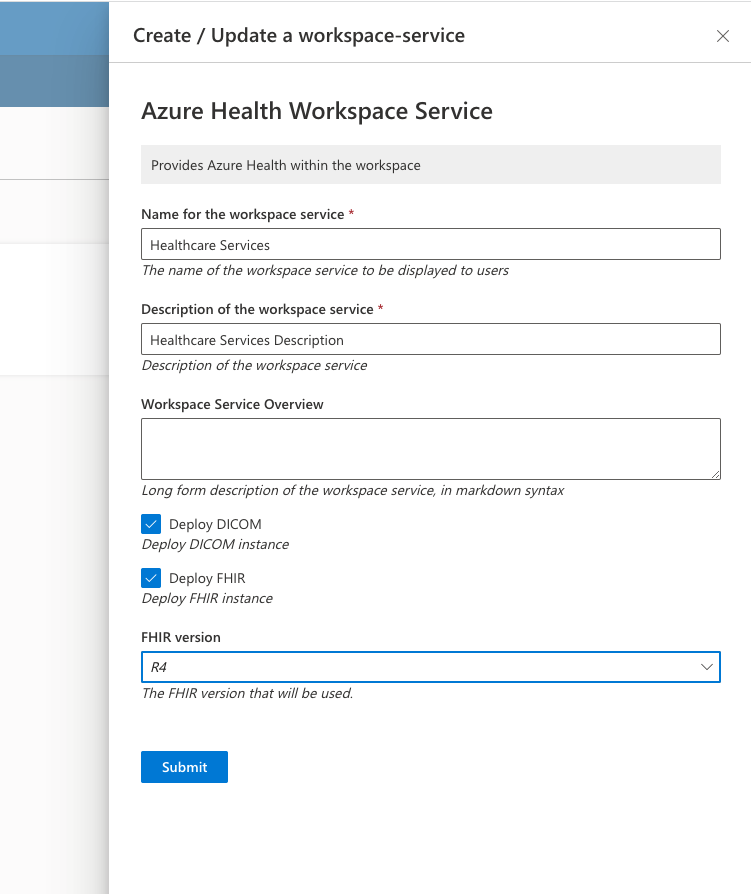

# Azure Health Data Services Workspace Service

See [Azure Health Data Services Documentation](https://learn.microsoft.com/en-us/azure/healthcare-apis/healthcare-apis-overview).

## Prerequisites

- [A base workspace deployed](https://microsoft.github.io/AzureTRE/tre-templates/workspaces/base/)

## Azure Healthcare Workspace

Each Azure Health Data Services workspace service creates a [Healthcare Workspace](https://learn.microsoft.com/en-us/azure/healthcare-apis/workspace-overview).
In addition, when creating this workspace service you can choose to deploy [FHIR](https://learn.microsoft.com/en-us/azure/healthcare-apis/fhir/) and [DICOM](https://learn.microsoft.com/en-us/azure/healthcare-apis/dicom/) instances within the newly created healthcare workspace.

## Install failures before version 1.0.0

Before version 1.0.0, an install can fail after Azure creates the FHIR service.
If Azure reports the FHIR service as `Accepted` after the create, the azurerm provider stops its wait, and Terraform does not save the FHIR service.
After this failure, each update and each delete of the Health service fails.
To repair the service, delete its FHIR service in the Azure portal, and then delete the Health service again.

Before version 1.0.0, an install without FHIR and DICOM can fail at the private endpoint.
Azure keeps the failed endpoint, but Terraform does not save it. After this failure, each update and each delete of the Health service fails.
To repair the service, delete the private endpoint `pe-hs<suffix>` of the service in the Azure portal. Its provisioning state is `Failed`.
Then delete the Health service, or upgrade it and turn on FHIR or DICOM with an update.

## Private network access

The service connects the healthcare workspace to the workspace network through one private endpoint.
Azure fails an endpoint to a healthcare workspace without a FHIR or DICOM service. So Terraform creates the endpoint after FHIR and DICOM, and each Health service must deploy FHIR, DICOM or both.
If an install, an update or an upgrade has neither FHIR nor DICOM, Terraform stops before it changes a resource, with the message "Deploy FHIR, DICOM or both".
This applies to an upgrade of an earlier Health service without FHIR and DICOM. The upgrade dialog of the TRE UI cannot change a property.
If the upgrade stops for this reason, update the service and turn on FHIR or DICOM, or delete the service.
A disable of such a service also stops at this check, but the delete then works.
If a request turns on FHIR without `fhir_kind`, the service gets FHIR R4. The update form of the TRE UI does not send `fhir_kind`.
Azure writes the private DNS records of a zone when the DNS zone group of this endpoint gets that zone.
The DNS zone group always has the zone for the healthcare workspace and FHIR. It has the DICOM zone only when the service has DICOM.
If an update adds DICOM, Terraform adds the DICOM zone to the group, and Azure writes the DICOM record. The endpoint stays.
The FHIR record is in the same zone as the healthcare workspace record. So if an update adds or removes FHIR, Terraform deletes the group before the FHIR change and creates it again after the change. Azure then writes the records again.
Private access to the healthcare workspace and DICOM stops until the new group exists. For an update that adds FHIR, this time includes the FHIR create. In tests, the whole update that adds FHIR took 12 to 18 minutes.
If the FHIR change fails, the new group does not exist, and private access stays stopped. To repair the service, run the update again.
If the update fails again, set `deploy_fhir` back to its earlier value. Terraform then creates the group for the other services.
If Azure has a FHIR service that Terraform did not save, delete that FHIR service in the Azure portal first.
Azure links a new service to the endpoint some minutes after Terraform creates the service.
During this time, Azure refuses a change to the DNS zone group with HTTP 409, and Terraform tries again.

Before version 1.0.0, the endpoint resource created the DNS zone group, and the group did not change when an update added a service.
If you added DICOM to an existing service before this version, the DICOM host can resolve to a public address.
An upgrade to version 1.0.0 deletes the old DNS zone group and creates a new one, so Azure writes the missing record.
Terraform deletes the old group after the changes to FHIR and DICOM, directly before it creates the new group.
Until the upgrade creates the new group, the private DNS records do not exist, and private access to the services stops.
Do not delete a working private endpoint to repair the service.

The DICOM service has public network access turned off.
Before version 1.0.0, Terraform created the DICOM service with public network access on.
An upgrade to version 1.0.0 turns it off.

The private endpoint on the healthcare workspace blocks public traffic to FHIR and DICOM.
A request from outside the workspace network gets HTTP 403.
The FHIR service reports `publicNetworkAccess` `Enabled`, but Azure does not use this value when the workspace has an approved private endpoint.
Azure also keeps this value when a request sets it to `Disabled`.

## Authentication

Learn more about authentication and application roles in [this doc](https://learn.microsoft.com/en-us/azure/healthcare-apis/authentication-authorization). Make sure to assign your users/apps with the required role and follow the guidelines to retrieve a token.

Notice: If you are using a separate tenant for authentication follow [this documentation](https://learn.microsoft.com/en-us/azure/healthcare-apis/azure-api-for-fhir/configure-local-rbac) to assign users/apps to your FHIR instance.
